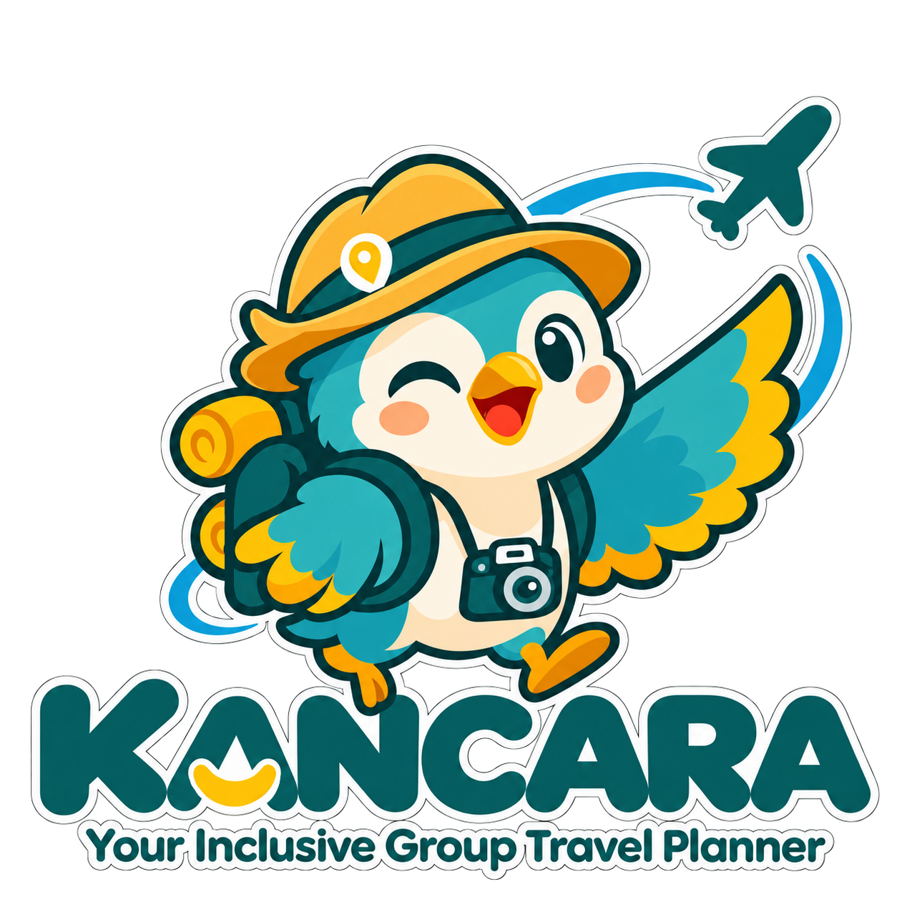

<div align="center">



# Kancara

**Plan a group trip where nobody gets left behind.**

</div>

---

## Why Kancara

Group trips usually get planned around whoever speaks up the most. The friend who
uses a wheelchair, the parent with a toddler, the grandparent who needs to rest
often, the one who eats halal or vegetarian, or the one on a tight budget ends up
quietly compromising, or staying home.

Kancara starts from the opposite end. You tell it who is coming and what each
person needs, and it plans a trip that works for all of them, then stays with the
group until everyone is home.

## What you can do with it

### Before the trip

- **Plan in a few questions.** Where you're going, when, your budget, and who is
  coming. For each person you can note what matters: a wheelchair, no stairs,
  short walks, halal or vegetarian food, naps, quiet places, a toilet nearby.
- **Get a day-by-day plan.** Captain, Kancara's guide, builds an itinerary and
  checks every stop against everyone's needs. Each stop shows clearly which needs
  it meets and which it only partly meets.
- **Settle different wishes fairly.** When members want different things, Kancara
  suggests a middle ground instead of picking a winner.
- **Have backups ready.** Each stop comes with alternatives for rain, a closed
  place, a full restaurant, or a tired group, already checked for your group.
- **Share one link with everyone.** Members join from a single group link, with
  or without an account.
- **Pack with confidence.** A packing list for each person, adjusted to the
  weather at your destination.
- **Keep it on paper.** Download the itinerary as a tidy PDF table.

### During the trip

- **See today at a glance.** What's happening now, what's next, and how long the
  drive is between stops, with a map of the day.
- **Change plans on the spot.** Rain, a closed place, or tired kids: swap in a
  backup for one stop or the rest of the day.
- **Read menus and talk to locals.** Scan a menu to see what suits each person's
  diet, and use the conversation translator face to face.
- **Carry a field pass.** The trip's essentials, stays, food notes, phrases, and
  emergency numbers, saved on your phone for when there's no signal.
- **Split the bill.** Record shared expenses and see exactly who owes whom.

### If someone gets separated

- **One button: "I'm separated".** The group is told right away, and the person
  sees the way to the meeting point, with a compass arrow on their phone.
- **Call or message in one tap.** The group leader and important local numbers
  are always close at hand.
- **A meeting card for those without a phone.** A small card with a code that a
  helpful stranger can scan to reach the group.

### After the trip

- **Look back together.** A trip recap with the route you took and the moments
  the group saved, with photos and notes.
- **Remember your travel companions.** Save the people you travel with and their
  needs, so the next trip starts already filled in.
- **See where you've been.** A map of the countries you have visited.

## Made for everyone

- **Inclusive by design.** Accessibility, dietary, rest, and sensory needs are
  part of every plan, not an afterthought.
- **Bahasa Indonesia and English.** Switch at any time.
- **Works offline.** The plan, the field pass, and the help page stay available
  without a connection.
- **Install it like an app.** Add Kancara to your phone's home screen.
- **Light and dark mode.** It follows your device, or you can choose.
- **Easy to use for everyone.** Large tap targets, clear contrast, and full
  keyboard and screen-reader support.

## Your data

Health notes, allergies, and phone numbers are encrypted before they are stored.
A group's information is only visible to the people in that group, and signing
out clears what was kept on the device.

---

<details>
<summary><strong>For developers</strong></summary>

### Run it locally

You need Node.js 20.9 or newer.

```bash
git clone https://github.com/FR21/Kancara.git
cd Kancara
npm install
npm run dev
```

Then open http://localhost:3000.

### Environment variables

Put these in a `.env` file at the project root. It is never committed.

| Variable | What it's for |
| --- | --- |
| `DATABASE_URL` | PostgreSQL (Neon) connection used by Prisma |
| `DATA_ENCRYPTION_KEY` | Encrypts health notes and phone numbers |
| `GEMINI_API_KEY` | Captain, the AI guide that writes plans, packing lists, translations, and menu checks |
| `GOOGLE_MAPS_API_KEY` | Server key for Google Places and travel times |
| `NEXT_PUBLIC_GOOGLE_MAPS_API_KEY` | Browser key for the maps (Maps JavaScript API and Geocoding API) |
| `NEXT_PUBLIC_FIREBASE_*`, `FIREBASE_*` | Sign-in and push notifications |
| `AWS_*`, `NEXT_PUBLIC_STORAGE_URL` | Object storage for profile and memory photos |
| `RAPIDAPI_KEY`, `RAPIDAPI_BOOKING_HOST` | Hotel search |
| `NEXT_PUBLIC_SITE_URL` | The site's public address, for links and search engines |
| `GOOGLE_SITE_VERIFICATION` | Optional: Google Search Console verification |

### Commands

| Command | What it does |
| --- | --- |
| `npm run dev` | Start the development server |
| `npm run build` | Build for production |
| `npm run start` | Run the production build |
| `npm run lint` | Check the code with ESLint |

### Where things are described

- `PRODUCT.md`: who Kancara is for and what it must feel like
- `DESIGN.md`: the design system (colors, type, corners, spacing, components)
- `rules.md`: the project's rules for code, design, and data
- `prisma/schema.prisma`: the database tables

Built with Next.js 16, React 19, TypeScript, Tailwind CSS 4, Prisma with
PostgreSQL (Neon), Firebase, and Google Gemini.

</details>
